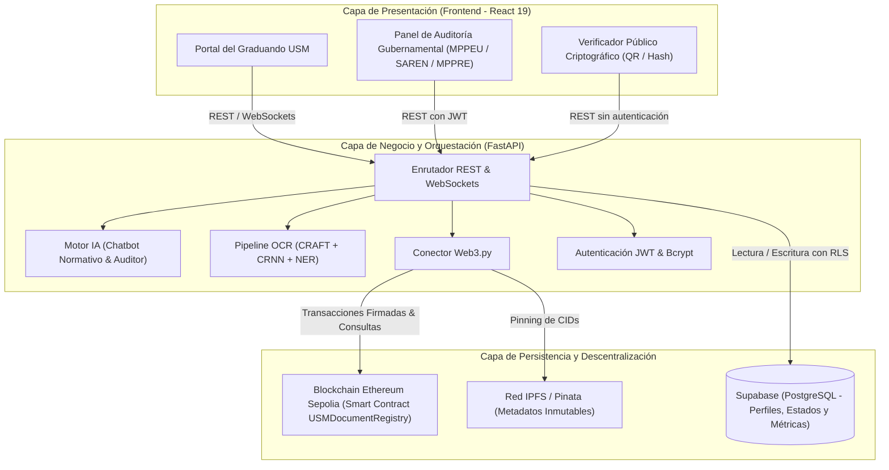

# 🏛️ DOCUMENTACIÓN TÉCNICA Y OPERATIVA DEL SISTEMA
## USM-ApostillaBot: Plataforma Descentralizada con Inteligencia Artificial y Blockchain para la Verificación y Tramitación de Documentos Académicos
**Proyecto de Grado para optar al Título de Ingeniero — Universidad Santa María (USM)**  
*Facultad de Ingeniería — Décimo Semestre*

---

## 📑 ÍNDICE GENERAL

1. [Información General y Alcance](#1-información-general-y-alcance)
2. [Requisitos Previos y Variables de Entorno](#2-requisitos-previos-y-variables-de-entorno)
3. [Guía de Arranque y Activación del Servidor](#3-guía-de-arranque-y-activación-del-servidor)
4. [Arquitectura del Sistema y Flujo de Datos](#4-arquitectura-del-sistema-y-flujo-de-datos)
5. [Módulos del Frontend (React 19 + Vite)](#5-módulos-del-frontend-react-19--vite)
6. [Módulos del Backend y Endpoints de la API (FastAPI)](#6-módulos-del-backend-y-endpoints-de-la-api-fastapi)
7. [Contrato Inteligente Blockchain (Solidity)](#7-contrato-inteligente-blockchain-solidity)
8. [Base de Datos y Persistencia (Supabase / PostgreSQL)](#8-base-de-datos-y-persistencia-supabase--postgresql)
9. [Protocolo y Guía para la Defensa de Grado](#9-protocolo-y-guía-para-la-defensa-de-grado)

---

## 1. INFORMACIÓN GENERAL Y ALCANCE

### 1.1. Contexto del Problema
Los graduandos de las distintas escuelas de la Facultad de Ingeniería de la Universidad Santa María (Sistemas, Civil, Industrial, Mecánica, Eléctrica, Arquitectura) enfrentan históricamente un complejo y fragmentado proceso burocrático para la autenticación, legalización y apostilla de sus documentos académicos en la República Bolivariana de Venezuela. Dicho trayecto involucra tres entidades gubernamentales distintas:

1. **MPPEU (GTU):** Ministerio del Poder Popular para la Educación Universitaria — Gestión de Trámites Universitarios (certificación y cotejo institucional del título).
2. **SAREN:** Servicio Autónomo de Registros y Notarías — Protocolización legal y pago de aranceles mediante la Planilla Única Bancaria (PUB).
3. **MPPRE:** Ministerio del Poder Popular para Relaciones Exteriores — Emisión de la Apostilla de La Haya electrónica para validez internacional.

Las principales debilidades del esquema tradicional son: altas tasas de rechazo presencial por errores subsanables (falta de firmas, timbres fiscales incorrectos, recaudos ilegibles), desinformación logística de las sedes físicas, ausencia de trazabilidad digital y vulnerabilidad ante la falsificación documental física.

### 1.2. Solución Propuesta
**USM-ApostillaBot** resuelve esta problemática a través de una arquitectura web integral descentralizada que combina:
- **Visión por Computadora (OCR con IA):** Extracción automatizada de datos a partir de diplomas y actas para evitar discrepancias humanas.
- **Asistente Virtual Especializado:** Chatbot interactivo dotado de base de conocimiento normativo venezolano y modo de auditoría en vivo.
- **Simulador de Pre-Validación:** Semáforo interactivo de verificación de requisitos previos antes del traslado físico.
- **Registro Inmutable en Blockchain:** Anclaje del hash criptográfico SHA-256 en la red pública de pruebas Ethereum Sepolia mediante un Smart Contract propio.
- **Panel Intergubernamental Multi-Ente:** Módulo de auditoría ministerial para cotejo (MPPEU) y apostillado (MPPRE) con certificación QR verificable públicamente.

### 1.3. Ficha Técnica del Stack
| Capa | Tecnologías Empleadas |
|---|---|
| **Frontend** | React 19, Vite 8, Tailwind CSS, Framer Motion, Lucide React, Ethers.js v6, HTML5-QRCode, HTML2PDF |
| **Backend API** | Python 3.10+, FastAPI, Uvicorn, WebSockets bidireccionales, Web3.py, PyJWT, Bcrypt |
| **Inteligencia Artificial / OCR** | EasyOCR (CRAFT + CRNN), Algoritmos de Extracción de Entidades (NER) basados en Expresiones Regulares |
| **Blockchain & Almacenamiento** | Solidity 0.8.20, Ethereum Sepolia Testnet, InterPlanetary File System (IPFS / Pinata) |
| **Base de Datos** | Supabase (PostgreSQL 15 con Row Level Security) |

---

## 2. REQUISITOS PREVIOS Y VARIABLES DE ENTORNO

### 2.1. Requisitos de Software
- **Node.js:** Versión 20.0.0 o superior (`node -v`).
- **npm:** Versión 10.0.0 o superior (`npm -v`).
- **Python:** Versión 3.10 o superior (`python --version`).
- **Git:** Para clonación y control de versiones.
- **Navegador Web:** Google Chrome, Brave, Firefox o Edge con soporte Web Crypto API y WebSockets.

### 2.2. Configuración de Variables de Entorno (`.env`)
En la raíz del proyecto (`Proyecto-Tesis-BlockChain/`) debe existir un archivo `.env`. A continuación se detalla cada parámetro:

```ini
# ==============================================================================
# CONFIGURACIÓN DEL BACKEND (FASTAPI)
# ==============================================================================
# Puerto y anfitrión de frontend autorizado para CORS
FRONTEND_URL=http://localhost:5173

# Clave secreta para la emisión y verificación de tokens JWT del panel administrativo
JWT_SECRET=super-secreto-tesis-usm-blockchain-2026

# ==============================================================================
# CONECTIVIDAD BLOCKCHAIN (ETHEREUM SEPOLIA)
# ==============================================================================
# Endpoint RPC de la red Sepolia (Infura, Alchemy o nodo público confiable)
WEB3_PROVIDER_URL=https://ethereum-sepolia-rpc.publicnode.com

# Dirección pública del contrato USMDocumentRegistry desplegado en Sepolia
CONTRACT_ADDRESS=0x9A4bF67448d3c52aE668601dC304859a22fA4960

# Llave privada de la wallet administradora (poseedora del rol onlyAdmin del contrato)
# NOTA: Debe disponer de fondos de Sepolia ETH (faucet) para costear el gas de registro
WALLET_PRIVATE_KEY=0xbd3b273b1e21dc84e9c89227f09fa69cd2f87818d74bfa63cc0504ee1fde3ba3

# ==============================================================================
# BASE DE DATOS Y PERSISTENCIA (SUPABASE)
# ==============================================================================
# URL del proyecto Supabase
SUPABASE_URL=https://tu-proyecto.supabase.co

# Clave de servicio de Supabase (anon key o service_role key)
SUPABASE_KEY=tu_supabase_anon_o_service_key

# ==============================================================================
# ALMACENAMIENTO DESCENTRALIZADO (IPFS & PINATA)
# ==============================================================================
PINATA_API_KEY=tu_pinata_api_key
PINATA_SECRET_KEY=tu_pinata_secret_key
PINATA_JWT=tu_pinata_jwt
PINATA_GATEWAY=https://gateway.pinata.cloud/ipfs

# ==============================================================================
# MODO DE DEFENSA DE TESIS (SALVAVIDAS PARA JURADO)
# ==============================================================================
# Si es true, el sistema permite continuar operando fluidamente aún si la testnet
# de Sepolia presenta alta latencia o saturación de gas durante la presentación
ALLOW_DEFENSE_DEMO_FALLBACK=true

# ==============================================================================
# CONFIGURACIÓN DEL FRONTEND (VITE)
# ==============================================================================
# URL del Backend para llamadas desde el navegador (en desarrollo local)
VITE_API_URL=http://localhost:8000
```

---

## 3. GUÍA DE ARRANQUE Y ACTIVACIÓN DEL SERVIDOR

### 3.1. Método Automatizado Unificado (Recomendado)
El proyecto cuenta con un orquestador en Python (`run_system.py`) que inicializa de manera coordinada el entorno virtual, las dependencias, el servidor FastAPI y el servidor de desarrollo Vite.

Para arrancarlo, abra una terminal en la raíz del proyecto y ejecute:

```bash
python run_system.py
```

**Comportamiento interno de `run_system.py`:**
1. Valida el entorno virtual (`venv`) e instala/actualiza dependencias de `requirements.txt`.
2. Lanza el proceso del Backend con Uvicorn en `http://localhost:8000` con recarga en vivo (`--reload`).
3. Lanza el proceso del Frontend con `npm run dev` en `http://localhost:5173`.
4. Monitorea los flujos de salida en tiempo real. Presionar `CTRL+C` finaliza ambos servicios de forma limpia.

---

### 3.2. Método Manual Paso a Paso (Dos Terminales)

Si prefiere ejecutar cada componente de forma independiente en terminales separadas:

#### Paso 1: Configurar e Iniciar el Backend (FastAPI)
Abra la primera terminal en la raíz del proyecto:

```bash
# 1. Crear el entorno virtual si no existe
python -m venv venv

# 2. Activar el entorno virtual en Windows (PowerShell):
.\venv\Scripts\Activate.ps1
# O en Windows (CMD):
venv\Scripts\activate.bat

# 3. Instalar las dependencias de Python
pip install -r requirements.txt

# 4. Iniciar el servidor Uvicorn
uvicorn api.main:app --host 0.0.0.0 --port 8000 --reload
```

> **Verificación:** Abra en su navegador `http://localhost:8000/docs` para ver la documentación interactiva Swagger de la API.

#### Paso 2: Iniciar el Frontend (Vite + React)
Abra una segunda terminal en la raíz del proyecto:

```bash
# 1. Instalar las dependencias de Node.js
npm install

# 2. Iniciar el servidor de desarrollo Vite
npm run dev
```

> **Verificación:** Abra en su navegador `http://localhost:5173` para acceder a la aplicación.

---

### 3.3. Inicialización del Esquema de Base de Datos en Supabase
Si utiliza una base de datos Supabase nueva:
1. Inicie sesión en [supabase.com](https://supabase.com).
2. Diríjase a su proyecto -> **SQL Editor** -> **New Query**.
3. Copie y pegue la totalidad del archivo [supabase_schema.sql](file:///c:/Users/Lenovo/.gemini/antigravity/scratch/Proyecto-Tesis-BlockChain/supabase_schema.sql).
4. Presione **Run**. Esto creará todas las tablas (`profiles`, `records`, `admins`, `stats`, `audit_logs`, `checklist_items`, `guias_logistica`, `planillas`, `carreras`, `pub_fields`) con sus políticas RLS y valores iniciales.

---

### 3.4. Despliegue del Smart Contract en Sepolia (Opcional si ya está desplegado)
El contrato ya está compilado y referenciado en el `.env`. Si desea volver a compilarlo y desplegarlo en una nueva dirección:
```bash
python deploy.py
```
*El script compila `blockchain/USMDocumentRegistry.sol` con `solc 0.8.20`, envía la transacción a Sepolia con su clave privada y actualiza automáticamente el campo `CONTRACT_ADDRESS` en su archivo `.env`.*

---

## 4. ARQUITECTURA DEL SISTEMA Y FLUJO DE DATOS

### 4.1. Diagrama de Arquitectura


### 4.2. Flujo de Vida del Documento Académico
1. **Digitalización & Extracción:** El graduando digitaliza su título. El módulo OCR reconoce la institución (USM), nombre, cédula y carrera.
2. **Pre-validación Física:** El sistema contrasta el expediente contra el checklist normativo del SAREN (firmas de autoridades, timbres fiscales).
3. **Generación PUB:** Se construye interactivamente la Planilla Única Bancaria validando en vivo los campos venezolanos.
4. **Fijado Criptográfico:** Se computa el Hash SHA-256 canónico del documento y se sube a IPFS.
5. **Anclaje en Sepolia:** El backend envía una transacción al Smart Contract registrando el hash, el nombre, la cédula y la marca de tiempo de forma inalterable.
6. **Cadena de Validación Ministerial:**
   - **MPPEU:** El funcionario realiza el cotejo de actas/folios y aprueba la validez universitaria.
   - **SAREN:** Protocoliza el registro público con los aranceles validados.
   - **MPPRE:** Genera la Apostilla electrónica de La Haya certificada con sello digital.
7. **Verificación Universal:** Cualquier entidad receptora en el mundo escanea el código QR del certificado y comprueba la validez directamente en la cadena de bloques.

---

## 5. MÓDULOS DEL FRONTEND (`src/`)

La interfaz de usuario está construida sobre una arquitectura de componentes reactivos en `src/components/`, controlados por el despachador de vistas principal en `src/App.jsx`.

### 5.1. `LandingPortal.jsx` — Portal de Entrada y Acceso Unificado
- **Propósito:** Punto de aterrizaje que orienta al usuario según su rol en el sistema.
- **Funcionalidad:**
  - Selector visual entre **Graduando de Ingeniería USM** y **Funcionario Gubernamental / Auditor**.
  - Modal de autenticación y registro de estudiantes con selección de carrera y semestre.
  - Modal de credenciales seguras para funcionarios (MPPEU, SAREN, MPPRE, Admin USM).

### 5.2. `Dashboard.jsx` — Panel de Control y Métricas en Tiempo Real
- **Propósito:** Mostrar de manera gráfica y animada el estado actual del ecosistema.
- **Componentes clave:**
  - **Cuatro contadores reactivos:** Graduandos Activos, Documentos Pre-validados, Horas Ahorradas (basado en tiempo medio de colas presenciales de 14.5 hrs) y Títulos Registrados en Blockchain.
  - **Conexión WebSocket (`/ws/stats`):** Escucha eventos broadcast para animar los números instantáneamente cuando otros usuarios interactúan con la plataforma.
  - **Live Audit Stream:** Consola de auditoría visual que despliega las últimas operaciones criptográficas y ministeriales ejecutadas.

### 5.3. `OCRExtractor.jsx` — Extracción Inteligente de Títulos con IA
- **Propósito:** Digitalizar documentos físicos eliminando errores de transcripción tipográfica.
- **Funcionalidad:**
  - Permite arrastrar o cargar imágenes del título universitario o notas certificadas.
  - Simula el pipeline de visión artificial en 5 etapas: Normalización, Reducción de Ruido, Detección de Regiones de Texto (CRAFT), Reconocimiento (CRNN) y Extracción de Entidades (NER).
  - Extrae y puntúa con porcentaje de confianza: Nombre completo, Cédula de Identidad, Universidad y Carrera.
  - Botón **"Transferir a Planilla PUB"** que precarga automáticamente el formulario SAREN.

### 5.4. `PreValidation.jsx` — Simulador de Pre-Validación Documental
- **Propósito:** Evitar que el estudiante acuda al registro con recaudos faltantes o erróneos.
- **Funcionalidad:**
  - Checklist dinámico de los 5 requisitos críticos del SAREN (Firma del Rector, Validación GTU, Planilla PUB, Nitidez >300 DPI, Timbres Fiscales).
  - Semáforo reactivo: Verde (Aprobado), Rojo (Error con sugerencia correctiva detallada) y Gris (Pendiente).
  - Reporta automáticamente la simulación al backend para incrementar el contador de documentos pre-validados.

### 5.5. `SurvivalGuide.jsx` — Guía Logística de Supervivencia
- **Propósito:** Proveer instrucciones tácticas y operativas para el día de la cita presencial en Caracas.
- **Funcionalidad:**
  - Filtro por Ente (**SAREN Principal La Candelaria** o **MPPRE Cancillería**) y Turno (**Mañana: 6:00 AM** o **Tarde: 11:30 AM**).
  - Hoja de ruta secuencial con horarios exactos de llegada, advertencias ambientales (sol, hidratación, ausencia de asientos) y mapa de ubicación.
  - Galería visual con fotografías reales de las fachadas oficiales para fácil reconocimiento.

### 5.6. `PUBForm.jsx` — Asistente de Llenado PUB con Validación en Vivo
- **Propósito:** Asistir al estudiante en la confección de la Planilla Única Bancaria del SAREN.
- **Funcionalidad:**
  - **Validación sintáctica en tiempo real:** Cédula venezolana (`V-`/`E-`), números telefónicos de operadoras nacionales (`0414`, `0424`, `0412`, `0416`, `0426`, `0212`), montos numéricos y banco emisor.
  - Resalta en rojo los campos con error y explica en un tooltip conversacional cómo subsanarlo.
  - Botón **"⛓️ Registrar Huella en Blockchain"**: Calcula el hash SHA-256 canónico y lo envía al Smart Contract en Sepolia.
  - Generación de PDF oficial mediante `html2pdf.js`.

### 5.7. `HistoryPanel.jsx` & `TrackingTimeline.jsx` — Historial y Trazabilidad
- **Propósito:** Ofrecer al graduando el seguimiento de sus documentos registrados.
- **Funcionalidad:**
  - Despliega cada trámite con su estado actual: *Pendiente de Auditoría*, *Cotejado por MPPEU*, *Verificado por SAREN*, *Apostillado por MPPRE* o *Rechazado*.
  - Enlace directo a Sepolia Etherscan para auditar la transacción original en la Blockchain pública.
  - Botones de acción para invocar el **Certificado Digital USM** o el **Certificado de Apostilla de La Haya**.

### 5.8. `BlockchainVerifier.jsx` & `QRScanner.jsx` — Verificador Público Descentralizado
- **Propósito:** Permitir a cualquier tercero (empresas, universidades extranjeras, consulados) validar la autenticidad de un documento sin requerir credenciales de usuario.
- **Funcionalidad:**
  - Consulta directa al Smart Contract en Sepolia por hash SHA-256.
  - Lector de código QR integrado (`html5-qrcode`) que permite escanear certificados físicos mediante la cámara del dispositivo o archivo de imagen.
  - Despliega: Estado de validez, Nombre del titular, Cédula de Identidad, Tipo de documento, Timestamp de emisión y Hash de la transacción.

### 5.9. `ChatBotWidget.jsx` — Asistente Virtual Especializado
- **Propósito:** Asistente conversacional con inteligencia artificial enfocado en la normativa de graduación y legalización de la USM.
- **Funcionalidad:**
  - Responde preguntas sobre aranceles, ubicaciones, requisitos de fondo negro y citas.
  - **Modo Auditoría Guiada:** Se activa con el comando `auditar` o el botón "🔎 Auditar mi Expediente"; guía al estudiante pregunta por pregunta revisando cada recaudo antes de generar el trámite.

### 5.10. `GovernmentPanel.jsx` & `MPPEUCotejoModal.jsx` — Panel de Auditoría Ministerial
- **Propósito:** Entorno exclusivo para los inspectores gubernamentales de los ministerios.
- **Funcionalidad:**
  - Selector de modo según el ente del funcionario: **MPPEU (Taquilla GTU)**, **SAREN (Registro)** o **MPPRE (Cancillería)**.
  - **Cotejo Ministerial MPPEU:** Modal de cotejo físico/digital donde se valida firma del Rector, Secretario General, sello de agua y coincidencia de acta y folio.
  - **Emisión de Apostilla MPPRE:** Genera el número oficial de apostilla (`APO-VE-2026-XXXXXX`) con registro inmutable.
  - Rechazo motivado con notificación inmediata al expediente del estudiante.

### 5.11. `AdminDashboard.jsx` — Módulo Administrativo USM
- **Propósito:** Otorgar a la Universidad Santa María control sobre los datos dinámicos.
- **Funcionalidad:**
  - CRUD para ítems de checklist, rutas de supervivencia logística y repositorio de planillas descargables.

---

## 6. MÓDULOS DEL BACKEND Y ENDPOINTS DE LA API (FASTAPI)

El backend expone una API REST moderna estructurada en `api/main.py` con documentación OpenAPI disponible en `/docs`.

### 6.1. Tabla Resumen de Rutas y Endpoints

| Método | Endpoint | Descripción | Acceso / Rol |
|---|---|---|---|
| `GET` | `/` | Health check y estado de servicios conectados | Público |
| `GET` | `/api/stats` | Contadores numéricos consolidados para el Dashboard | Público |
| `POST` | `/stats/heartbeat` | Incrementa tiempo de uso activo del estudiante | Público |
| `POST` | `/prevalidation/report` | Registra simulación de pre-validación | Público |
| `WS` | `/ws/stats` | WebSocket bidireccional de métricas en tiempo real | Público |
| `POST` | `/admin/login` | Autenticación de funcionarios gubernamentales y administradores | Público |
| `POST` | `/admin/users` | Creación de nuevos usuarios administrativos | Requiere JWT |
| `POST` | `/profiles/register` | Registro / actualización de graduando USM | Público |
| `GET` | `/profiles/{cedula}` | Obtención del perfil académico por cédula | Público |
| `POST` | `/blockchain/register` | Anclaje de documento en Smart Contract Sepolia / Supabase | Graduando / Admin |
| `GET` | `/blockchain/verify/{doc_hash}` | Verificación pública del estado inmutable en Blockchain | Público |
| `GET` | `/blockchain/records` | Listado general de documentos registrados | Público / Auditor |
| `GET` | `/blockchain/records/cedula/{cedula}` | Consulta de historial de trámites por graduando | Público |
| `POST` | `/blockchain/records/{doc_hash}/mppeu-certify` | Certificación y cotejo ministerial por el MPPEU | Auditor MPPEU |
| `POST` | `/blockchain/records/{doc_hash}/mppre-apostille` | Emisión electrónica de la Apostilla de La Haya | Auditor MPPRE |
| `POST` | `/blockchain/records/{doc_hash}/verify` | Validación general del trámite (SAREN / USM) | Auditor / Admin |
| `POST` | `/blockchain/records/{doc_hash}/reject` | Rechazo motivado de un documento | Auditor |
| `GET` | `/blockchain/certificate/{doc_hash}` | Datos consolidados para renderizar el Certificado Digital | Público |
| `POST` | `/blockchain/send-raw-tx` | Relay de transacciones firmadas por MetaMask (SSI) | Público |
| `POST` | `/hash/generate` | Generación de Hash SHA-256 en el servidor | Público |
| `POST` | `/chat/message` | Procesamiento del asistente inteligente y auditoría | Público |
| `POST` | `/ocr/extract` | Procesamiento OCR de imagen de diploma con EasyOCR/NER | Público |
| `GET` | `/guias` | Listado de rutas de supervivencia logística | Público |
| `POST` | `/admin/guias` | Creación de nueva guía logística | Requiere JWT |
| `GET` | `/planillas` | Repositorio de planillas oficiales descargables | Público |
| `POST` | `/admin/planillas` | Publicación de nueva planilla oficial | Requiere JWT |
| `DELETE` | `/admin/planillas/{id}` | Eliminación de una planilla | Requiere JWT |
| `GET` | `/admin/checklist` | Requisitos dinámicos de pre-validación | Público |
| `POST` | `/admin/checklist` | Alta de nuevo requisito | Requiere JWT |
| `PUT` | `/admin/checklist/{id}` | Modificación de requisito | Requiere JWT |
| `DELETE` | `/admin/checklist/{id}` | Baja de requisito | Requiere JWT |
| `GET` | `/carreras` | Catálogo de carreras de ingeniería de la USM | Público |
| `GET` | `/pub/fields` | Especificación de campos dinámicos para el SAREN | Público |

---

### 6.2. Detalle de Endpoints Críticos

#### `POST /blockchain/register`
- **Entrada:**
  ```json
  {
    "hash": "0x4A8F...",
    "owner_name": "CARLOS EDUARDO MENDOZA",
    "cedula": "V-27891234",
    "document_type": "Título de Ingeniero de Sistemas",
    "form_data": { ... }
  }
  ```
- **Lógica:** Si Web3 está conectado y la clave privada configurada tiene balance de gas, ejecuta `USMDocumentRegistry.registerDocument(...)` en Sepolia. Almacena en Supabase el transaction hash retornado (`tx_hash`). Si se activa el modo de contingencia de defensa, asegura la persistencia en base de datos local y memoria sin romper el flujo del usuario.
- **Salida Exitosa:** Retorna objeto de confirmación con `tx_hash`, `status` y enlace a Etherscan.

#### `GET /blockchain/verify/{doc_hash}`
- **Parámetro de ruta:** `doc_hash` (formato hexadecimal `0x...` o sin prefijo).
- **Lógica:** Ejecuta la función `verifyDocument(_hash)` del Smart Contract en Sepolia. Comprueba las banderas de `exists` y `isRevoked`. Devuelve el titular, la cédula y la fecha inmutable del bloque Ethereum.

#### `POST /blockchain/records/{doc_hash}/mppeu-certify`
- **Entrada:**
  ```json
  {
    "auditor_name": "Lic. María Rodríguez",
    "auditor_cargo": "Directora de Cotejo GTU",
    "acta_numero": "ACT-2026-0891",
    "folio_numero": "FOL-412"
  }
  ```
- **Lógica:** Actualiza el estado del registro a `"Cotejado por MPPEU"` y añade la bitácora ministerial en `audit_logs`.

#### `POST /blockchain/records/{doc_hash}/mppre-apostille`
- **Entrada:**
  ```json
  {
    "auditor_name": "Emb. Carlos Soto",
    "country_destiny": "España",
    "notes": "Apostilla de La Haya Electrónica Conforme"
  }
  ```
- **Lógica:** Asigna código oficial de apostilla, actualiza el estatus a `"Apostillado por MPPRE"` y genera la estructura de validez internacional.

#### `POST /ocr/extract`
- **Entrada:** Imagen en formato Base64.
- **Lógica:** Invoca la red neuronal EasyOCR para reconocimiento óptico de caracteres en español e inglés. Segmenta el texto crudo y aplica expresiones regulares especializadas para extraer: Nombre del egresado, Cédula de Identidad, Denominación de la Universidad Santa María y Especialidad de Ingeniería.

---

## 7. CONTRATO INTELIGENTE BLOCKCHAIN (SOLIDITY)

Ubicación del código fuente: [blockchain/USMDocumentRegistry.sol](file:///c:/Users/Lenovo/.gemini/antigravity/scratch/Proyecto-Tesis-BlockChain/blockchain/USMDocumentRegistry.sol)  
Red destino: **Ethereum Sepolia Testnet** (Chain ID: `11155111`)

```solidity
// SPDX-License-Identifier: MIT
pragma solidity ^0.8.20;

/**
 * @title USMDocumentRegistry
 * @notice Registro inmutable y certificable de documentos validados de la Universidad Santa María.
 *         Implementa control de acceso basado en roles (onlyAdmin) y revocación de credenciales.
 */
contract USMDocumentRegistry {

    address public institutionAdmin;
    uint256 public totalDocumentsCount;

    struct Document {
        string documentHash;     // CID de IPFS o Hash SHA-256 del documento
        string ownerName;        // Nombre del graduando
        string cedula;           // Cédula de identidad
        string documentType;     // Tipo de documento (PUB, Título, etc.)
        address registeredBy;    // Wallet de la autoridad que registró
        uint256 timestamp;       // Unix timestamp del registro
        bool exists;             // Bandera de existencia
        bool isRevoked;          // Bandera de validez/revocación
    }

    mapping(string => Document) private documents;

    event DocumentRegistered(
        string indexed documentHash,
        string ownerName,
        string cedula,
        string documentType,
        uint256 timestamp
    );

    event DocumentRevoked(
        string indexed documentHash,
        uint256 timestamp
    );

    modifier onlyAdmin() {
        require(msg.sender == institutionAdmin, "Acceso denegado: Solo la autoridad institucional puede ejecutar esta accion");
        _;
    }

    constructor() {
        institutionAdmin = msg.sender;
        totalDocumentsCount = 0;
    }

    function registerDocument(
        string calldata _hash,
        string calldata _ownerName,
        string calldata _cedula,
        string calldata _documentType
    ) external onlyAdmin {
        require(!documents[_hash].exists, "El documento ya se encuentra registrado");
        require(bytes(_hash).length > 0, "El hash no puede estar vacio");

        documents[_hash] = Document({
            documentHash: _hash,
            ownerName: _ownerName,
            cedula: _cedula,
            documentType: _documentType,
            registeredBy: msg.sender,
            timestamp: block.timestamp,
            exists: true,
            isRevoked: false
        });

        totalDocumentsCount++;
        emit DocumentRegistered(_hash, _ownerName, _cedula, _documentType, block.timestamp);
    }

    function revokeDocument(string calldata _hash) external onlyAdmin {
        require(documents[_hash].exists, "El documento no existe");
        require(!documents[_hash].isRevoked, "El documento ya ha sido revocado");

        documents[_hash].isRevoked = true;
        emit DocumentRevoked(_hash, block.timestamp);
    }

    function verifyDocument(string calldata _hash)
        external
        view
        returns (
            bool exists,
            bool isRevoked,
            string memory ownerName,
            string memory cedula,
            string memory documentType,
            uint256 timestamp
        )
    {
        Document memory doc = documents[_hash];
        return (doc.exists, doc.isRevoked, doc.ownerName, doc.cedula, doc.documentType, doc.timestamp);
    }
}
```

### Características Criptográficas Clave
- **Sin Costo para Verificadores (`view`):** La función `verifyDocument` se ejecuta en modo lectura local; ninguna entidad gubernamental o particular requiere saldo de criptomonedas para validar un título emitido.
- **Inmutabilidad y Trazabilidad:** Cada registro emite el evento `DocumentRegistered`, indexable por el explorador de bloques (Etherscan).
- **Protección Institucional (`onlyAdmin`):** Únicamente la wallet firmante de la Universidad Santa María posee privilegios para acuñar nuevos registros en el contrato.

---

## 8. BASE DE DATOS Y PERSISTENCIA (SUPABASE / POSTGRESQL)

El sistema utiliza Supabase para persistir metadatos y configuraciones dinámicas.

### 8.1. Diccionario de Tablas Principales
- **`profiles`:** Almacena cédula (PK), nombre, carrera de ingeniería y semestre del estudiante.
- **`admins`:** Contiene los usuarios de fiscalización de los entes gubernamentales (MPPEU, SAREN, MPPRE, USM) con passwords hasheados en Bcrypt.
- **`records`:** Registro híbrido de documentos anclados a la blockchain (`hash`, `owner_name`, `cedula`, `document_type`, `tx_hash`, `status`, `created_at`).
- **`stats`:** Contadores globales (`graduandos_activos`, `docs_prevalidados`, `tiempo_ahorrado_hrs`, `titulos_blockchain`).
- **`audit_logs`:** Registro cronológico de actividades y eventos de auditoría para el panel principal.
- **`checklist_items`:** Banco de preguntas y validaciones físicas del checklist SAREN con soporte para actualización dinámica sin reiniciar el servidor.
- **`guias_logistica`:** Estructura JSONB con los pasos de supervivencia para cada ente y turno.
- **`planillas`:** Catálogo de enlaces y nombres de formatos oficiales institucionales.
- **`carreras`:** Listado de especialidades de ingeniería autorizadas en la USM.

---

## 9. PROTOCOLO Y GUÍA PARA LA DEFENSA DE GRADO

Para garantizar una presentación exitosa y fluida ante el Jurado Calificador, siga este orden de demostración práctica:

### 9.1. Preparación Previa
1. Inicie el sistema con `python run_system.py`.
2. Verifique que el Frontend esté visible en `http://localhost:5173`.
3. Verifique que el Backend responda en `http://localhost:8000/docs`.
4. Tenga a mano un teléfono móvil con cámara para escanear el código QR del Certificado Digital.

### 9.2. Guión de Demostración en Vivo ("Efecto WOW")
1. **Paso 1 — Panel Principal:** Muestre el Dashboard y explique las métricas de impacto (especialmente el indicador de *Horas Ahorradas* basado en las 14.5 horas de colas físicas en Caracas).
2. **Paso 2 — OCR con Inteligencia Artificial:** Vaya a la pestaña "Extractor OCR". Suba una imagen de muestra de un título. Muestre cómo el modelo CRAFT + CRNN extrae los datos y presione "Transferir a Planilla PUB".
3. **Paso 3 — Asistente de Llenado PUB y Rechazo en Vivo:** En la Planilla PUB, intente colocar intencionalmente una cédula mal formateada o un teléfono incorrecto. Muestre al jurado cómo el sistema rechaza el dato con un marco rojo explicativo. Luego, complételo correctamente y presione **"⛓️ Registrar Huella en Blockchain"**.
4. **Paso 4 — Auditoría Ministerial:** En otra pestaña del navegador (o en modo incógnito), inicie sesión como funcionario del **MPPEU** (`mppeu_agente`). Abra la solicitud recién creada, ejecute el **Cotejo Ministerial de Actas y Folios** y apruebe el documento.
5. **Paso 5 — Emisión de Apostilla y Verificación QR:** Cambie al rol de Cancillería (**MPPRE**), emita la Apostilla de La Haya y abra el Certificado Digital. Pídale a un jurado que escanee el código QR con su propio teléfono móvil: el enlace abrirá directamente el **Verificador Descentralizado**, demostrando la inmutabilidad y autenticidad en tiempo real.

---
*Documento elaborado conforme a las normas de trabajo especial de grado de la Facultad de Ingeniería — Universidad Santa María.*

