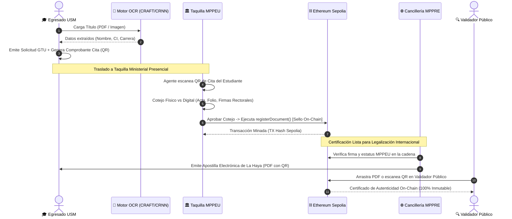

# 🧠 Documento Maestro de Inicialización y Control (Antigravity AI)
**Proyecto:** Sistema Distribuido de Autenticación y Legalización de Títulos Universitarios mediante Blockchain (TEG).  
**Institución:** Universidad Santa María (USM) — Facultad de Ingeniería  
**Objetivo del Documento:** Proveer a la IA (Antigravity) del contexto absoluto, la matriz de módulos, el estado actual auditado de desarrollo, la verificación del flujo de procesos transversal y los prompts de ejecución para el avance iterativo.

---

## ⚙️ INSTRUCCIONES PARA EL AGENTE DE IA (ANTIGRAVITY)
Al leer este documento, debes asimilar la arquitectura del sistema y prepararte para ejecutar tareas en tres roles principales: **Project Manager (PM), UI/UX Designer, y FullStack/Blockchain Developer**. Tu objetivo es ayudar al usuario a auditar, codificar y diseñar este sistema iterativamente, basándote en las fases descritas abajo.

---

## 📊 PARTE 1: EVALUACIÓN Y AUDITORÍA DE MÓDULOS (ESTADO ACTUAL)
*Matriz de auditoría técnica contrastando requerimientos vs. implementación funcional en el código fuente.*

| Módulo Requerido | Descripción Core | Estado Actual | Elementos Implementados y Validados |
| :--- | :--- | :---: | :--- |
| **1. Auth & RBAC** | Gestión de identidades y roles (Egresado, MPPEU, MPPRE, Admin). | 🟢 **Operativo** | Esquema de BDD de usuarios y perfiles (`admins`, `profiles`), JWT Auth (`pyjwt`), hashing seguro (`bcrypt`), validación de PIN institucional SoD (`GOV_INSTITUTIONAL_PINS`), selectores de acceso con Presets en `LandingPortal.jsx`. |
| **2. Portal Egresado** | Frontend para carga de PDF/Imagen y seguimiento de estado. | 🟢 **Operativo** | UI/UX Stepper editorial Steep, dropzone con soporte PDF e imágenes (hasta 15MB), pre-validación de recaudos, integración con OCR y emisión de Comprobante Oficial de Cita GTU con Código QR y descarga en PDF (`OCRExtractor.jsx`, `PUBForm.jsx`). |
| **3. Motor OCR Core** | Extracción automática de datos desde el título PDF/Imagen. | 🟢 **Operativo** | Pipeline híbrido (Tesseract.js WASM en cliente + EasyOCR con CRAFT y CRNN en backend `/ocr/extract`), extracción semántica de entidades (Nombre, Cédula, Universidad, Carrera, Fecha), métricas de confianza y edición de campos en vivo. |
| **4. Módulo MPPEU** | Panel de validación física híbrida y disparador Blockchain. | 🟢 **Operativo** | Panel Ministerial MPPEU en `GovernmentPanel.jsx`, lector de Código QR de cita con cámara (`Html5QrcodeScanner`), modal de cotejo de firmas rectorales, sello de agua y cédula (`MPPEUCotejoModal.jsx`), detonación on-chain inmutable en Sepolia (`mppeu-certify`) y rechazo motivado. |
| **5. Módulo MPPRE** | Verificación Blockchain y generación de Apostilla PDF. | 🟢 **Operativo** | Bandeja de entrada de Cancillería (condicionada a previa certificación MPPEU), emisión de Apostilla Electrónica de La Haya (10 campos oficiales estandarizados) con código oficial (`APO-VE-2026-XXXX`), código QR y descarga en PDF (`ApostilleCertificate.jsx`). |
| **6. Blockchain Core** | Smart Contracts y registro de Hashes. | 🟢 **Operativo** | Smart Contract en Solidity 0.8.20 (`USMDocumentRegistry.sol`) con control de roles (`onlyAdmin`), anclaje de CIDs IPFS y hashes SHA-256; verificación sin consumo de Gas (`verifyDocument`), script de despliegue `deploy.py` a Ethereum Sepolia y conector Web3.py. |
| **7. Notificaciones** | Alertas transversales por cambios de estado. | 🟢 **Operativo** | Notificaciones contextuales (`ToastNotification.jsx`), bitácora de auditoría en tiempo real con WebSockets bidireccionales (`/ws/stats`), actualización reactiva de líneas de tiempo de trámites (`TrackingTimeline.jsx`, `HistoryPanel.jsx`). |
| **8. Validador Público** | Portal web abierto para consulta de QR y Hash. | 🟢 **Operativo** | Validador universal sin credenciales (`BlockchainVerifier.jsx`), Dropzone de PDF/Imagen con cálculo instantáneo de SHA-256 en cliente (Web Crypto API), escáner QR de cámara, consulta directa on-chain y tarjetas comparativas (Auténtico vs Alerta de Falsificación/Alteración). |

---

## 🔄 PARTE 2: FLUJO DE PROCESOS LÓGICO Y CONEXIÓN OPERATIVA
*Todo el ciclo de vida del trámite se encuentra interconectado respetando el siguiente flujo:*

1. **Fase Egresado:** Carga PDF/Imagen -> Motor OCR extrae datos -> Usuario aprueba/edita -> Pre-llenado PUB -> Generación de Comprobante de Cita GTU con Código QR.
2. **Fase MPPEU:** Egresado asiste -> Agente escanea QR con el lector integrado -> Compara físico vs digital en modal de cotejo -> Agente aprueba -> Detona Smart Contract (Sello Blockchain Sepolia).
3. **Fase MPPRE:** Bandeja Cancillería detecta documento certificado por MPPEU -> Emite Apostilla Electrónica de La Haya con PDF oficial y QR.
4. **Fase Pública:** Terceros arrastran el PDF o escanean el QR en el Validador Descentralizado -> Comprobación matemática instantánea en Sepolia.

---

## 🛠️ PARTE 3: PLANIFICACIÓN Y CARGA DE TRABAJO (FASES AUDITABLES)

### 📍 Fase 1: Infraestructura y Base de Datos (Backend Core)
*   **Tareas:** Modelo Entidad-Relación en PostgreSQL (Supabase `supabase_schema.sql`). Servidor FastAPI (`api/main.py`). Autenticación JWT y roles RBAC (Egresado, MPPEU, MPPRE, SAREN, Admin USM). Red Ethereum Sepolia (Chain ID 11155111) y compilación del Smart Contract `USMDocumentRegistry.sol`.
*   **Auditoría de Cierre:** ✅ **COMPLETADA**. El sistema gestiona identidades y roles independientes con PIN institucional SoD, y el contrato compila y ejecuta `verifyDocument` y `registerDocument` en Sepolia.

### 📍 Fase 2: Frontend, OCR y Carga de Documentos (Portal Egresado)
*   **Tareas:** UI/UX del Dashboard del Egresado con Steep Editorial Light Design System. Pipeline de OCR híbrido (Tesseract.js + EasyOCR). Flujo de carga con validación de tamaño (hasta 15MB) y pre-visualización de entidades. Emisión de solicitud con generación de ticket de cita GTU con QR descargable.
*   **Auditoría de Cierre:** ✅ **COMPLETADA**. El usuario sube un título o acta, el OCR extrae los datos, permite editarlos, registra la solicitud con estado `PENDIENTE_COTEJO` y genera el comprobante oficial con código QR listo para imprimir.

### 📍 Fase 3: Lógica de Instituciones (MPPEU y MPPRE)
*   **Tareas:** Panel de Agentes Gubernamentales (`GovernmentPanel.jsx`). MPPEU: Lector QR integrado en barra de búsqueda, modal de cotejo físico vs digital (`MPPEUCotejoModal.jsx`) y detonador de escritura en Blockchain (`mppeuCertifyRecord`). MPPRE: Filtrado de expedientes con certificación previa del MPPEU y emisión de Apostilla de La Haya con firma digital y PDF descargable (`ApostilleCertificate.jsx`).
*   **Auditoría de Cierre:** ✅ **COMPLETADA**. Se conecta el ciclo ministerial híbrido: el agente MPPEU aprueba el cotejo tras escanear el QR del alumno, la transacción queda anclada en Sepolia y la Cancillería (MPPRE) habilita la emisión inmediata de la Apostilla.

### 📍 Fase 4: Validador Público y Cierre
*   **Tareas:** Portal de verificación abierto sin inicio de sesión (`BlockchainVerifier.jsx`). Selector de 3 modalidades: 1) Dropzone de PDF/Imagen con cómputo SHA-256 en cliente vía Web Crypto API, 2) Búsqueda directa por Hash, 3) Escáner QR de cámara. Tarjetas visuales de resultado: Documento Auténtico vs Alerta de Documento Falso/Modificado (Efecto Avalancha).
*   **Auditoría de Cierre:** ✅ **COMPLETADA**. Al arrastrar un archivo legítimo se valida su coincidencia on-chain; si el archivo es alterado en un byte, arroja la alerta de "Documento No Encontrado o Modificado" con explicación criptográfica.

---

## 🎯 PARTE 4: PROMPTS DE EJECUCIÓN ESPECIALIZADA
*Usuario: Copia y pega el prompt que necesites en el chat con tu IA para activar un rol específico.*

### 📋 [PROMPT - PROJECT MANAGER & ARQUITECTO]
> "Antigravity, asume el rol de Technical Project Manager. Revisa la 'PARTE 1' y 'PARTE 3' de nuestro Documento Maestro. Quiero auditar la Fase 1. Genera el Modelo Entidad-Relación (MER) necesario para soportar todos los módulos listados. Define las tablas, campos principales, tipos de datos y relaciones (especialmente cómo vincularemos el usuario con el documento y el Hash de la blockchain)."

### 🎨 [PROMPT - UI/UX DESIGNER]
> "Antigravity, asume el rol de Experto en UX/UI. Lee la 'PARTE 2' de nuestro Documento Maestro. Vamos a diseñar el 'Portal Egresado'. Dame la estructura de componentes de la interfaz para la pantalla de 'Carga y Validación OCR'. Necesito saber qué librerías de componentes sugieres, cómo se distribuirá la pantalla (PDF vs Formulario) y cómo manejar la experiencia de usuario si el OCR arroja un error."

### 💻 [PROMPT - FULLSTACK & BLOCKCHAIN DEVELOPER]
> "Antigravity, asume el rol de Senior Developer. Basado en el 'Módulo 6' de nuestro Documento Maestro, escribe el código inicial del Smart Contract en Solidity. El contrato debe poder recibir un Hash (del PDF), la dirección (wallet) de la institución que firma (MPPEU), y la marca de tiempo (timestamp). Asegúrate de incluir funciones para que el MPPRE pueda consultar la validez de ese Hash. Dame el código listo para auditar."
